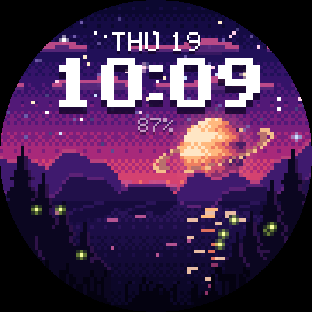
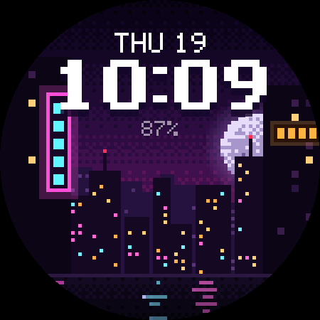
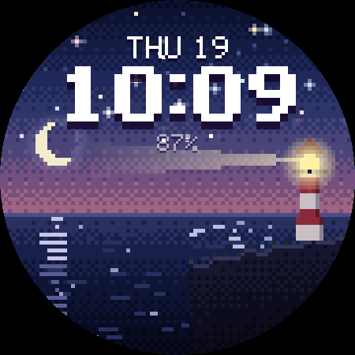
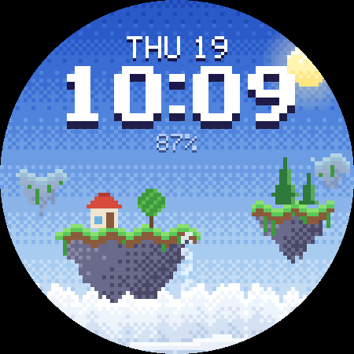
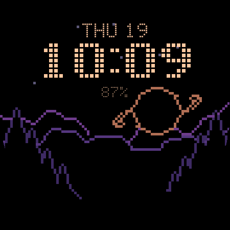

# Nightfall

A pixel-art parallax watch face for the Galaxy Watch 8 (any Wear OS 5+ watch). Each scene is a stack of
layers that slide by different amounts as you tilt your wrist, with looping animations and a pixel bitmap
font for the clock. No code inside: it's a Watch Face Format v2 package (XML + PNGs).

| Lake | Aurora | Neon city | Dunes |
|---|---|---|---|
|  |  |  |  |
| **Lighthouse** | **Meadow** | **Sky islands** | |
|  |  |  | |

- **Lake**: ringed planet over a lake. Twinkling stars, drifting clouds, a shooting star at :00 and :30, water shimmer, fireflies.
- **Aurora**: northern lights over snowy peaks. Rippling aurora, snow in two depths, a cabin with a flickering window and chimney smoke.
- **Neon city**: rainy skyline. Rain in two depths, flying cars, windows switching on and off, blinking antennas, a flickering sign.
- **Dunes**: retro sunset over the desert. Birds, drifting clouds, blowing sand.
- **Lighthouse**: dusk on the coast. The beam turns in 3D (it stretches, flips sides and flares when it faces you), a boat and gulls pass, waves foam on the rocks.
- **Meadow**: a sunny morning. Two wind turbines turn, a hot-air balloon drifts over, butterflies flutter, grass sways.
- **Sky islands**: grassy islands float over a sea of clouds, each bobbing at its own depth. A waterfall pours off the
  edge, an airship and a flock of birds pass, and the clouds roll by below.

## Options (long-press the face, then Customize)

- **Scene**: pick one of the seven.
- **Auto scene (time of day)**: ignore the picked scene and follow the clock: Meadow 6-10, Sky islands 10-14,
  Dunes 14-17, Lighthouse 17-20, Neon city 20-23, Lake 23-3, Aurora 3-6. Edit `SCHEDULE` in `gen/gen.py` to change it.
- **Live weather** (on by default): the scene follows the weather on your watch. Clouds roll in when it's cloudy, fog
  sits on the horizon, rain or snow falls, storms flash, and wind blows streaks across. Scenes with weather built in
  (Neon's rain, Aurora's snow, Dunes' sand) only show it when the real weather matches.
  With no weather data, every scene looks as designed.
- **Calm (fewer animations)**: keeps the tilt parallax but freezes the looping animations and hides anything that
  travels across the screen. Saves battery while the screen is on.

Always-on: each scene has dim line art of its own landscape with a dot-matrix clock in the scene's colour, lighting
7-13% of the screen. There's also a tiny, faint battery % under the clock.

 

## Build / install

```bash
./build.sh            # generates the art + watchface.xml, builds and signs out/nightfall.apk
./build.sh install    # ...and adb installs it (connect the watch over wireless debugging first)
```

Then long-press the current face on the watch and pick **Nightfall**.

Needs the Android SDK (`aapt2`, `zipalign`, `apksigner`), a JDK, and Python 3. No Gradle, no Pillow.

## Tweaking

Everything is generated by `gen/gen.py`; `res/raw/watchface.xml` and the PNGs are build output.

- Each `scene_*()` function builds one scene; `S.add(name, depth, ...)` adds a layer that slides `depth` px at full
  tilt (keep it under `PAD`, 30). `S.marker("wx_sky")` / `S.marker("wx_fog")` mark where weather clouds / fog go.
  Add the function to `SCENES` and it appears in the picker.
- `TILT` / `FLIP_X` / `FLIP_Y`: how much wrist tilt counts as full tilt, and which way things slide.
- `GLYPHS`: the 5x7 pixel font (clock bold at 10 px per pixel, date at 4, battery at 3).
- `AOD_STYLE`: each scene's always-on colours and which layers get traced.
- `out/preview_<scene>.png`, `_tilt.png`, `aod_<scene>.png`: stills for checking things off-watch.
