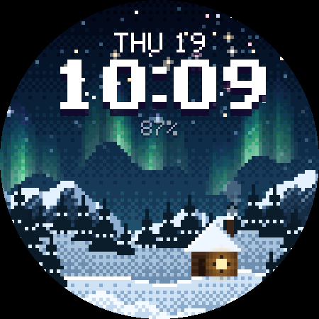
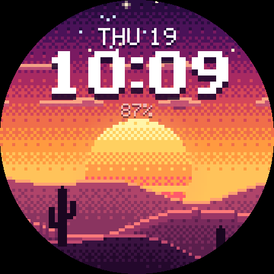
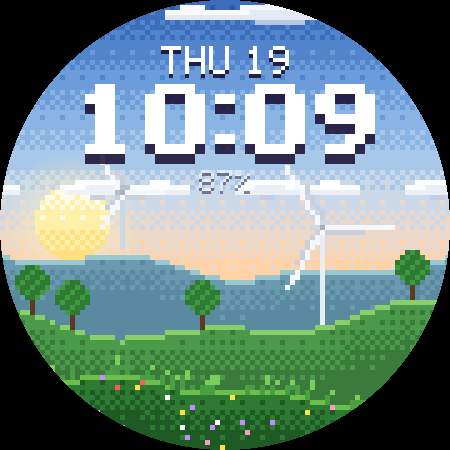
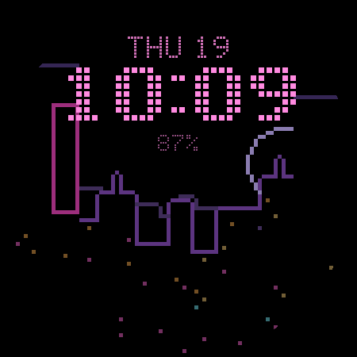

# Nightfall

A pixel-art parallax watch face for the Galaxy Watch 8 (any Wear OS 5+ watch). Each scene is a stack of
layers that slide by different amounts as you tilt your wrist, with looping animations and a pixel bitmap
font for the clock. No code inside: it's a Watch Face Format v2 package (XML + PNGs).

| Lake | Aurora | Neon city | Dunes |
|---|---|---|---|
|  |  |  |  |
| **Lighthouse** | **Meadow** | **Sky islands** | |
|  |  |  | |

- **Lake**: ringed planet over a lake. Twinkling stars, drifting clouds, a shooting star at :00 and :30, water shimmer, fireflies.
- **Aurora**: northern lights over snowy peaks. Rippling aurora, snow in two depths, a cabin with a flickering window and chimney smoke.
- **Neon city**: rainy skyline. Rain in two depths, flying cars, windows switching on and off, blinking antennas, a flickering sign.
- **Dunes**: retro sunset over the desert. Birds, drifting clouds, blowing sand.
- **Lighthouse**: dusk on the coast. The beam turns in 3D (it stretches, flips sides and flares when it faces you), a boat and gulls pass, waves foam on the rocks.
- **Meadow**: a sunny morning. Two wind turbines turn, a hot-air balloon drifts over, butterflies flutter, grass sways.
- **Sky islands**: grassy islands float over a sea of clouds, each bobbing at its own depth. A waterfall pours off the
  edge, an airship and a flock of birds pass, and the clouds roll by below.

## Options (long-press the face, then Customize)

- **Scene**: pick one of the seven.
- **Auto scene (time of day)**: ignore the picked scene and follow the clock: Meadow 6-10, Sky islands 10-14,
  Dunes 14-17, Lighthouse 17-20, Neon city 20-23, Lake 23-3, Aurora 3-6. Edit `SCHEDULE` in `gen/gen.py` to change it.
- **Live weather** (on by default): the scene follows the weather on your watch. Clouds roll in when it's cloudy, fog
  sits on the horizon, rain or snow falls, storms flash, and wind blows streaks across. Scenes with weather built in
  (Neon's rain, Aurora's snow, Dunes' sand) only show it when the real weather matches.
  With no weather data, every scene looks as designed.
- **Calm (fewer animations)**: keeps the tilt parallax but freezes the looping animations and hides anything that
  travels across the screen. Saves battery while the screen is on.

Always-on: each scene has dim line art of its own landscape with a dot-matrix clock in the scene's colour, lighting
7-13% of the screen. There's also a tiny, faint battery % under the clock.

 

## The Nightfall app (`drawer/`)

A companion Wear OS app that themes the rest of the watch to match the face: pixel font, the current scene as the
background (following the same schedule as Auto scene, or pinned from the drawer).

- **Drawer**: every app's icon redrawn as pixel art, pixel labels; long-press to pin. Tap the scene name to change scene.
- **Inbox**: your notifications as pixel cards with pixel app icons. Tap to open, hold to dismiss, CLEAR ALL.
- **Control panel**: Do Not Disturb, a flashlight, brightness, Wi-Fi / Bluetooth / Settings shortcuts, a
  "Samsung" button for the real quick panel, and on/off switches for each swipe.
- **Tiles**: *Day* (date, steps, battery, next calendar event), *Weather* (now + the next hours, Open-Meteo),
  *Music* (what's playing on the watch, with controls), *Flick* (pick the preset your watch beams).

### Swipes (optional)

Samsung's own screens can't be replaced without root, so the app has an accessibility service, *Nightfall swipes*,
that watches only Samsung's system UI and swaps in Nightfall's screen when one of these appears:

| Gesture on the face | Samsung's screen | Becomes |
|---|---|---|
| swipe up (or Home) | app list | Nightfall drawer |
| swipe right | notifications | Nightfall inbox |
| swipe down | quick panel | Nightfall control panel |

To keep it seamless, Nightfall's screens live in one activity that stays alive in the service's warm process, so
it comes to the front instantly with no splash screen, sliding in the direction you swiped, straight over
Samsung's screen. Leaving it presses Home, which resets Samsung's screen underneath to the face. Each swipe can be
switched off in the control panel; the inbox and panel have buttons to reach Samsung's real versions.
Measured cost on a Galaxy Watch 8: ~8 MB of memory, ~0.1 s of CPU a minute with the screen off, roughly 0.2-0.5%
battery a day.

### One-time setup (on the watch, or adb for the two special permissions)

1. **Swipes**: Settings > Accessibility > Installed apps > *Nightfall swipes* > On.
2. **Tiles**: open the control panel, tap **TILES: ALLOW ACCESS** (steps, calendar, approximate location).
3. **Inbox, DND and the Music tile** need notification access. Wear OS has no screen for it, so grant it once with:
   ```bash
   adb shell cmd notification allow_listener com.rusty.nightfall.drawer/com.rusty.nightfall.drawer.NotifListener
   ```
4. **Brightness** needs "modify system settings":
   ```bash
   adb shell appops set com.rusty.nightfall.drawer WRITE_SETTINGS allow
   ```
5. Add the tiles: long-press the tiles screen, then **Add** the Nightfall tiles.
6. For the side button: Settings > Advanced features > Customize buttons > Double press > **Nightfall Drawer**.

The Weather tile sends only an approximate location (rounded to about 10 km) to api.open-meteo.com, and only uses a
location saved while a Nightfall screen is open. The Flick tile needs Flick built with the same signing key
(it reads presets through Flick's signature-protected provider).

```bash
./build.sh drawer     # builds drawer/ with Gradle and installs it on the watch
```

## Build / install

```bash
./build.sh            # generates the art + watchface.xml, builds and signs out/nightfall.apk
./build.sh install    # ...and installs it on the watch (connect it over wireless debugging first;
                      #    other adb devices like phones or TVs are ignored)
```

Then long-press the current face on the watch and pick **Nightfall**.

Needs the Android SDK (`aapt2`, `zipalign`, `apksigner`), a JDK, and Python 3. No Gradle, no Pillow.

## Tweaking

Everything is generated by `gen/gen.py`; `res/raw/watchface.xml` and the PNGs are build output.

- Each `scene_*()` function builds one scene; `S.add(name, depth, ...)` adds a layer that slides `depth` px at full
  tilt (keep it under `PAD`, 30). `S.marker("wx_sky")` / `S.marker("wx_fog")` mark where weather clouds / fog go.
  Add the function to `SCENES` and it appears in the picker.
- `TILT` / `FLIP_X` / `FLIP_Y`: how much wrist tilt counts as full tilt, and which way things slide.
- `GLYPHS`: the 5x7 pixel font (clock bold at 10 px per pixel, date at 4, battery at 3).
- `AOD_STYLE`: each scene's always-on colours and which layers get traced.
- `out/preview_<scene>.png`, `_tilt.png`, `aod_<scene>.png`: stills for checking things off-watch.
